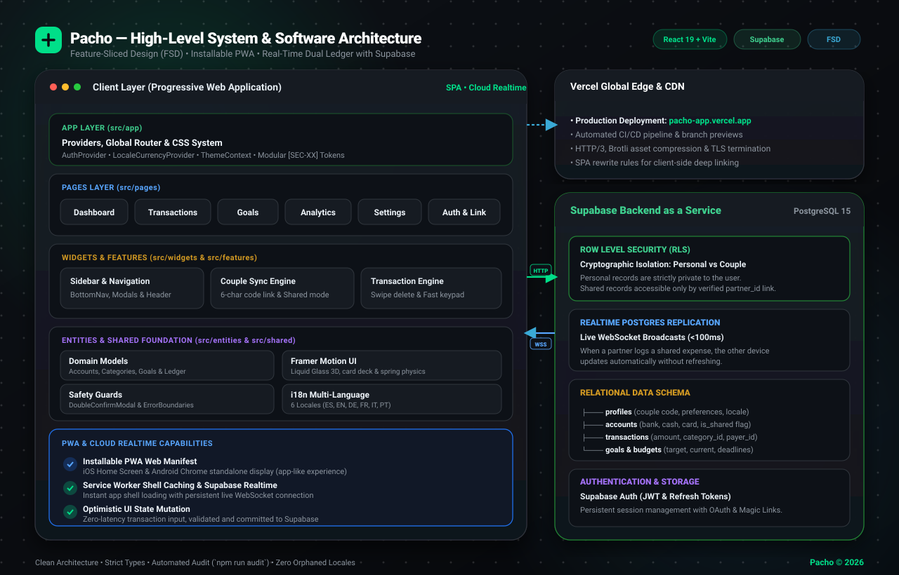
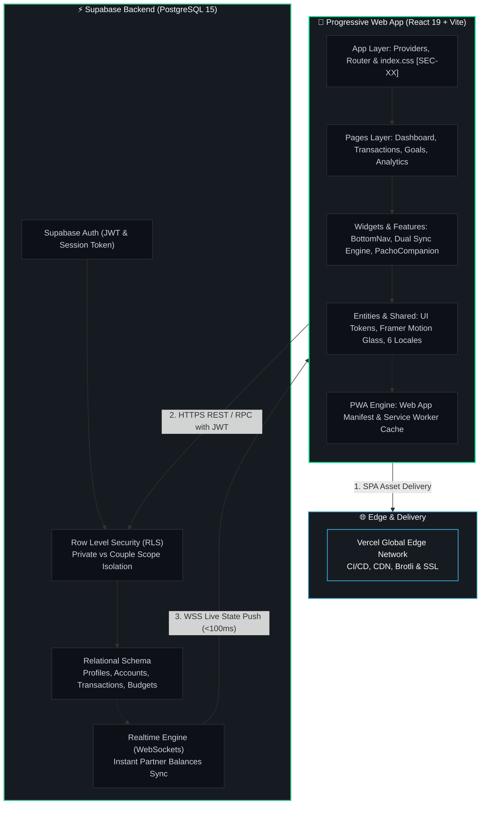

<h1 align="center">
  Pacho
   
</h1>

  Your Personal &amp; Shared Finance Companion
   
   
  <a href="https://pacho-app.vercel.app">Website</a>
  ·
  <a href="https://pacho-showcase.vercel.app">Live Demo</a>

  
  
  
  
  
  

  
    Built with clean architecture &amp; real-time cloud synchronization
     
    <em>"Las cuentas claras y el chocolate espeso. Lleva tus finanzas a pachas sin líos."</em>
  

---

## About Pacho

**Pacho** is a modern, high-performance Progressive Web Application (PWA) designed to eliminate money friction for couples, housemates, and families. 

Traditional budgeting tools are either rigid spreadsheets or single-user expense trackers. Pacho introduces a **dual-ledger paradigm**: keep your personal accounts 100% private while syncing shared household expenses, rent, groceries, and common savings goals in real-time with your partner.

Engineered with production-grade architectural standards: **React 19**, **Feature-Sliced Design (FSD)**, **Supabase Realtime WebSockets**, strict **Row Level Security (RLS)**, and a **Liquid Glass** aesthetic powered by Framer Motion.

> 🔒 *Note: This is a public showcase & architectural case study repository. Core commercial source code is retained in the private production codebase.*

---

## Features

<table>
  <tr>
    <td width="50%" valign="top">
      <h3>🤝 Dual-Ledger &amp; Couple Linking</h3>
      
Instant couple synchronization via a secure 6-character code. Personal accounts remain completely isolated, while shared accounts replicate with sub-100ms latency.

    </td>
    <td width="50%" valign="top">
      <h3>🎯 3D Interactive Goals &amp; Budgets</h3>
      
Shared and individual savings targets with circular progress rings, multi-account allocation, deadline projections, and safe-to-spend estimations.

    </td>
  </tr>
  <tr>
    <td width="50%" valign="top">
      <h3>📊 Visual Analytics &amp; Safe-to-Spend</h3>
      
Interactive donut breakdowns, monthly category spending trends, and real-time safe daily allowances to ensure smooth end-of-month finances.

    </td>
    <td width="50%" valign="top">
      <h3>⚡ Ergonomic 3-Second Input</h3>
      
Custom numeric keypad, swipe-to-delete gestures, interactive 3D liquid card carousel, pull-to-refresh, and live cloud synchronization via Supabase.

    </td>
  </tr>
</table>

---

## System &amp; Software Architecture

The application is structured around the **Feature-Sliced Design (FSD)** methodology, guaranteeing separation of concerns, high maintainability, and domain scalability.

  

### Architectural Highlights

1. **Client Tier (PWA &amp; React 19)**:
   - **Feature-Sliced Design Layers**: Strict inward dependency flow (`app` &rarr; `pages` &rarr; `widgets` &rarr; `features` &rarr; `entities` &rarr; `shared`).
   - **Installable PWA**: Dedicated Web App Manifest for seamless home screen installation on iOS and Android with app-like standalone display.
   - **Modular CSS Tokens**: High-performance CSS custom properties without runtime overhead, strictly cataloged by section identifiers `[SEC-XX]`.
   - **6 Synchronized Locales**: Native multi-language support (ES, EN, DE, FR, IT, PT) verified by strict automated parity test harnesses.

2. **Backend &amp; Security Tier (Supabase BaaS &amp; PostgreSQL 15)**:
   - **Row Level Security (RLS)**: Enforces privacy at the database engine level. Private transactions are cryptographically blocked from non-owners; shared entries are accessible only by verified `partner_id` links.
   - **PostgreSQL Realtime**: Changes to shared accounts, transactions, or goals broadcast via WebSockets directly to the linked partner's device in under 100ms.
   - **JWT Auth &amp; Session Management**: Secure user identity handling, session renewal, and passwordless authentication flows.

3. **CI/CD &amp; Delivery Tier (Vercel)**:
   - Automated preview deployments, edge caching, asset compression (Brotli/Gzip), and global HTTPS termination at [pacho-app.vercel.app](https://pacho-app.vercel.app/).

---

## Architectural Flowchart (Mermaid)

---

## Design Philosophy &amp; Visual Identity

Pacho combines modern minimalism with ergonomic readability and expressive micro-interactions:

- **Emerald Green (`#00DF89`)**: Growth, security, and financial vitality.
- **Deep Obsidian (`#121214`)**: Premium dark-mode contrast with ergonomic eye relief.
- **Micro-Interactions**: Floating levitations, spring physics, and glassmorphic overlays.
- **Clarity &amp; Typography**: High-contrast typography paired with accessible financial breakdowns.

---

## Live Links &amp; Showcase

- 🚀 **Official Web Application**: [pacho-app.vercel.app](https://pacho-app.vercel.app/)  
- 📱 **Interactive Showcase &amp; Emulator**: [pacho-showcase.vercel.app](https://pacho-showcase.vercel.app/)

---

  Pacho &copy; 2026 — Clean Architecture • High Performance • Shared Finances with Zero Stress.

